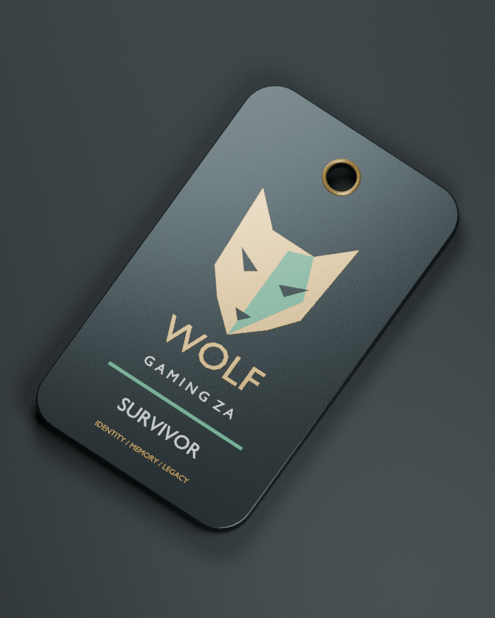

# WolfGamingZA Dog Tags

An original DayZ 1.30 survivor identity mod. No code, models, textures or branding
from the referenced Workshop mod are included.

**Development candidate, not a production release.** Source and packaging are
prepared; DayZ compilation and multiplayer behaviour still require an actual
server/client test. The runtime item temporarily uses vanilla paper geometry.

[Download the unsigned development ZIP](https://github.com/skullrazor-Vyvorant/WolfGamingZA-DogTags/raw/refs/heads/main/releases/WGZA_DogTags-dev.zip).
Its SHA-256 checksum is recorded in [releases/SHA256SUMS](releases/SHA256SUMS).

For Steam distribution, use the [Workshop preparation guide](docs/WORKSHOP.md)
and [Windows source/signing kit](https://github.com/skullrazor-Vyvorant/WolfGamingZA-DogTags/raw/refs/heads/main/releases/WGZA_DogTags-Workshop-kit.zip).
The kit uses official DayZ Tools on Windows; it is not an already signed mod or
a published Steam item. A Steam login and actual DayZ validation are still required.

## Implemented in source

- A dedicated player attachment slot, added to the native inventory UI.
- Server-issued tag on first connection, including for existing survivors.
- Reuse of the saved tag on reconnect; fresh lives receive new UUIDs.
- Original owner name, Steam64 ID, UTC issue time, full UUID and short display ID.
- Living-owner inventory restrictions and an engine slot lock; trophies cannot
  replace another survivor's own identity tag.
- Death callback releases the tag and records UTC death time, normalized
  post-fatal health and the engine-reported killer/source.
- Item persistence plus a server-side JSON archive per UUID.
- Authorized, rate-limited RPC reads and refreshed native hover/middle-click
  inspection. Native inspection also displays current item condition.
- Central Economy configuration, a reproducible unsigned development PBO/ZIP,
  and an original Blender model/concept source in `assets/`.

All gameplay features above are **unverified in DayZ**. The asset sources still
need DayZ LODs, texture baking, P3D/PAA conversion and integration. A new inventory
slot alone does not add a visible tag/chain to character models.

## Build and check

Use Python 3.10 or newer; no Python packages are required:

```sh
cd /workspace/WolfGamingZA-DogTags
python3 -m unittest discover -s tests -v
python3 tools/build.py
```

Output: `dist/WGZA_DogTags-dev.zip`. It contains the unsigned PBO, mod metadata,
server economy files, a testing guide and SHA-256 checksums. Config remains
unbinarized source in this development PBO. Packaging does not compile Enforce
Script or validate game assets.

The packaging tests verify archive contents, checksums, repeatability, source
preservation and rejection of accidental local files, symlinks and case clashes.
See [the required in-game test guide](docs/TESTING.md) for installation, signing,
expected gameplay behaviour and known limitations. Load the mod on **both**
server and clients, using a disposable test instance first.

## Original asset source



The original design uses dark steel, gold and forest green. See
[the asset pipeline notes](assets/README.md) for editable files and conversion
steps. To regenerate using Blender 4.3 or newer:

```sh
BLENDER_USER_CONFIG=/tmp/wgza-blender-config BLENDER_USER_EXTENSIONS=/tmp/wgza-blender-extensions blender --background --threads 2 --python tools/create_assets.py
```

The generator overwrites its generated artist-source files; preserve any manual
edits before running it. Artist source and previews are excluded from the runtime
package until suitable DayZ assets are integrated.

## Persistence and compatibility

`CreatedUTC` records issue time, not a reconstructed birth date for survivors
who existed before installation. Death source is unknown when the engine does
not supply it; previous attackers are not guessed. Health is normally zero in
the death callback. Eight-character display IDs can collide; full UUIDs are the
identity keys.

The tag item is authoritative persistence. Archives are written to
`$profile:WGZA_DogTags/records/<uuid>.json` on issuance and observed death. They
are not an automatic recovery database. Ordinary inventory protection does not
cover admin deletion, force-moves by other mods or inconsistent backup restores.
Trophies follow ordinary corpse/container/economy cleanup rules.

The initial untested Paper-based scaffold's storage is superseded, without a
migration. This mod adds no custom data to the player persistence stream.

## Cloud workflow

Use this existing checkout; cloud tasks already run in isolation and do not
need another Git worktree. Python 3.12 and Blender 4.3.2 were available here.
DayZ, DayZ Tools, Wine and SteamCMD were not present. No game compilation,
server startup or multiplayer test has been performed. Full validation requires
a licensed DayZ client, a test dedicated server and DayZ Tools on Windows for
asset conversion/signing. No external script framework, API key or web service
is required by the mod.

Hooks were compared against Bohemia's published
[DayZ Script Diff](https://github.com/BohemiaInteractive/DayZ-Script-Diff/tree/78be1c402eec249e4e4cdac7e1fef71006e94d20)
(Build 1.30.164289, scripts revision 127855). The source-PBO format was checked
against the public
[armake2 implementation](https://github.com/KoffeinFlummi/armake2/blob/3cc3362101900ff41504db3e780dd1625634cf94/src/pbo.rs).
Those reference checks are static review, not a game compile.
